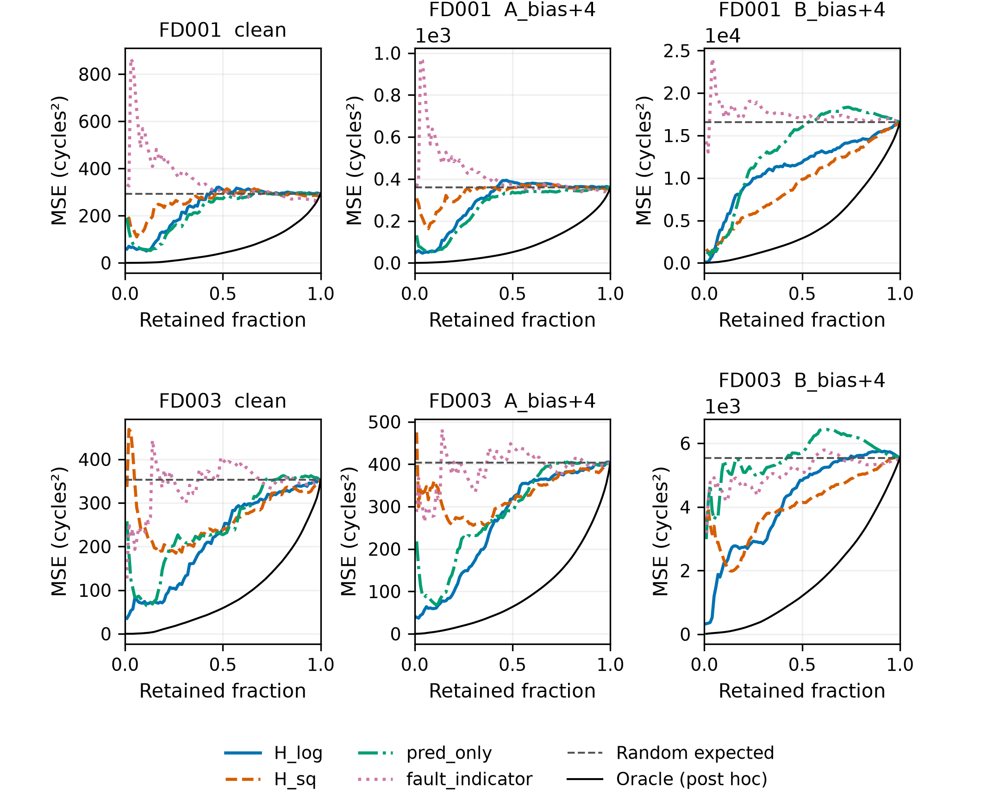

# RiskSelRUL for reproducible selective remaining useful life evaluation

Jinxian Wu

College of Publishing, University of Shanghai for Science and Technology, Shanghai 200093, China

Corresponding author: Jinxian Wu. Email: 2435050925@st.usst.edu.cn

## Abstract

RiskSelRUL is an open-source Python toolkit for explicit acceptance accounting in selective remaining useful life evaluation. It separates calibrated-threshold decisions from fixed-count ranking and reports accepted counts, retained errors and reference risks. Reusable NumPy interfaces accept predictions and scores from external regression workflows. A complete C-MAPSS sensor-fault benchmark provides engine-grouped fitting, reproducible corruption and saved-table checking. Validation spans two engine datasets, three training seeds and three fault streams. Diabetes and synthetic Friedman examples demonstrate reuse beyond RUL. Executable examples, numeric inference states, automated tests and reproducibility records support installation, inspection and extension.

## Keywords

remaining useful life; selective regression; software; reproducibility; sensor faults; evaluation

## Metadata

| Nr | Metadata value |
| --- | --- |
| C1 | 0.1.1.dev0 |
| C2 | https://github.com/huahuobuku-design/riskselrul/tree/5a90e3140d8d9c0610b7e8f6a7121d0f6277fb32 |
| C3 | Apache-2.0 |
| C4 | Git |
| C5 | Python; NumPy; optional pandas, SciPy, scikit-learn and threadpoolctl |
| C6 | Python >=3.10. NumPy core; optional train extra. Ubuntu and Windows CI with Python 3.10 and 3.12. |
| C7 | https://github.com/huahuobuku-design/riskselrul/blob/5a90e3140d8d9c0610b7e8f6a7121d0f6277fb32/docs/API.md |
| C8 | 2435050925@st.usst.edu.cn |

## 1. Motivation and significance

Selective remaining useful life (RUL) prediction trades prediction availability against error on accepted inputs. For example, an apparently lower retained RMSE can accompany a substantial reduction in the number of engines served. Researchers need to distinguish improvement at a common retained count from changes caused by applying different acceptance thresholds. RiskSelRUL makes these conditions part of an executable evaluation: each reported error is associated with the predictor, input cohort and accepted count that produced it.

The software connects a complete sensor-fault benchmark with reusable numerical interfaces. Users can reproduce a grouped training and calibration workflow, compare risk scores under matched faults, or evaluate prediction arrays from their own models. Separate threshold and fixed-count paths answer complementary questions: whether a calibrated decision rule transfers to new inputs, and how effectively a score ranks prediction errors at a chosen retained count.

Existing software supplies important parts of this workflow. CeRULEo provides RUL data preparation, feature engineering and model evaluation [1], while NASA ProgPy supports prognostics modelling, simulation, estimation and uncertainty propagation [2]. SelectiveNet and regression-with-rejection methods study predictive selection [3,4]; conformal approaches support RUL uncertainty and rejection [5,6]. MAPIE and Uncertainty Toolbox provide conformal prediction, risk-control and uncertainty diagnostics [7,8]. RiskSelRUL complements these tools with explicit acceptance accounting and a reproducible sensor-fault evaluation workflow. The underlying risk–coverage trade-off is established in selective prediction [9].

## 2. Software description

### 2.1. Architecture and data flow

The package has numerical diagnostics, archived inference and an optional training workflow. Version 0.1.1.dev0 adds input validation and a general-regression example to the frozen 0.1.0 computational baseline; predictor and selection calculations are unchanged. The numerical layer consumes one-dimensional prediction, target and risk-score arrays. `fixed_k_metrics` returns selected indices, retained errors and reference errors at a specified retained count; `risk_coverage_curve` repeats this evaluation across counts. `calibrate_threshold` fits an empirical score quantile using separate calibration observations, and `prediction_metrics` evaluates an accepted subset. This layer requires NumPy and operates independently of the RUL training code.

The raw-data workflow is `extract-data / inspect-data -> reproduce -> saved tables -> audit / curve`. It checks original files, constructs engine-grouped folds, fits preprocessing within each fold, trains predictors and risk scores, freezes calibration thresholds and writes per-engine test results. Four fixed predictors combine Ridge or histogram gradient boosting with clean or fault-augmented training. The risk-score variants predict log absolute error (`H_log`), squared error (`H_sq`), squared error from the point prediction alone (`pred_only`), or use a deterministic missing/stuck-sensor indicator. Out-of-fold residuals provide risk-head targets.

A separate NumPy inference path loads 78 bundled numeric states. Each state contains the main Ridge predictor, preprocessing statistics, a linear risk head and frozen thresholds. Inputs have shape `(n, 30, 21)`; missing sensor values are represented by NaN and imputed with stored training statistics. All states are included in the wheel and source distribution and are read with `allow_pickle=False`. The archived inference profile and the raw-data benchmark have separately documented fitting configurations.

The arithmetic checker reads saved calibration, threshold, prediction and metric tables and recalculates their relationships. It checks accepted sets, fixed-count ordering, retained errors and reference values without importing training or inference modules. It rejects empty test tables and tables without prediction columns. Its benchmark schema and numerical tolerances are documented in the API reference and supplementary material.

### 2.2. Evaluation interfaces

Threshold evaluation accepts a new score when `score <= threshold`; the threshold uses NumPy's linear empirical quantile. Reports contain realized acceptance, accepted counts and retained error. Fixed-count evaluation selects the `k` smallest scores. Ties use a stable sample-identifier SHA-256 ordering, followed by input position, so selection remains independent of target labels.

Empty accepted sets return `None` error values, which serialize to JSON `null`. The retrospective oracle ranks known errors and provides a diagnostic lower bound. Uniform random retention has expected MSE equal to the full-cohort MSE for every nonempty retained count; the software reports this expectation directly. Fixed-count curves describe cohort ranking, while frozen thresholds describe decisions applied to individual new inputs. The examples additionally summarize each full curve by discrete AURC-MSE, the mean retained MSE over k=1,...,n, with units of the squared target. The supplementary diagnostic script reports the NASA asymmetric error score both as a total and per accepted engine, so changes in accepted count remain visible [10].

Table 1 summarizes how users can combine RiskSelRUL with related software. Predictions and scalar scores enter through the array API; model training remains with the originating tool.

| Software | Primary documented use | Relationship to RiskSelRUL |
| --- | --- | --- |
| CeRULEo | RUL data preparation, models and evaluation | Predictions can supply the evaluation arrays |
| ProgPy | Prognostics modelling, simulation and uncertainty propagation | Complements model-based prognostics outputs |
| MAPIE | Conformal intervals/sets and risk control | Different inferential guarantees; scores can be evaluated separately |
| Uncertainty Toolbox | Regression uncertainty metrics and visualization | Complementary distributional diagnostics |
| SelectiveNet implementation | Joint predictive/selection model examples | Supplies a selection method rather than this benchmark workflow |
| RiskSelRUL | Explicit threshold and fixed-count acceptance accounting | NumPy diagnostics plus a fixed sensor-fault benchmark |

Table 1. Documented software scope and relationship to the RiskSelRUL evaluation interfaces.

## 3. Illustrative examples

### 3.1. Installation and a minimal example

Install the supplied wheel or run `python -m pip install .` from the source root for NumPy diagnostics and archived inference. Install `python -m pip install '.[train]'` for the raw-data benchmark and saved-table auditing. The companion `quickstart_arrays.py` provides an immediate input-to-output example:

```python
prediction = [10, 12, 9, 15, 8, 13, 11, 14]
target     = [11, 10, 8, 14, 10, 12, 10, 11]
score      = [.7, .1, .4, .8, .3, .2, .6, .5]
from riskselrul import fixed_k_metrics
result = fixed_k_metrics(prediction, target, score, k=4)
print(result['retained']['mse'])  # 2.5
```

These eight synthetic inputs illustrate the API. Run `python quickstart_arrays.py --out example_output` to save the input CSV, output JSON and risk–coverage curve. A threshold calibrated on the separate scores `[.1, .2, .3, .4, .5]` at target acceptance 0.6 equals 0.34 and accepts three inputs. Fixed `k=4` accepts four. Table 2 shows the resulting outputs.

| Evaluation path | Accepted / 8 | Realized acceptance | Retained MSE |
| --- | ---: | ---: | ---: |
| Fixed k=4 | 4 | 0.50 | 2.50 |
| Frozen threshold 0.34 | 3 | 0.375 | 3.00 |
| All retained | 8 | 1.00 | 2.75 |
| None retained | 0 | 0.00 | — |

Table 2. Executed array example. The dash marks undefined retained error for an empty set. The uniform-random expected MSE is 2.75 for every nonempty retained count.

### 3.2. A reproducible engine example

NASA C-MAPSS provides simulated turbofan trajectories [11,12]. FD001 and FD003 each have 100 source training and 100 separate test engines under a single operating condition, with one and two simulated failure modes, respectively [11]. The frozen profile fits 70 engines, calibrates on 15 and reserves the remaining 15. Five grouped out-of-fold splits supply risk-head training residuals, with preprocessing fitted only on the corresponding fitting engines.

Fault augmentation acts on sensor group A (`s2,s4,s8,s11,s13,s15,s20`); group B (`s3,s7,s9,s12,s14,s17,s21`) provides held-out channels. The 21 test scenarios cover clean inputs, missing and stuck sensors, signed bias and drift. Hash-addressed random streams ensure matched models receive the same corrupted windows. A bias magnitude of four means four clean-training sensor standard deviations. The source configuration defines onset sampling, affected channels and all scenario names.

Point predictors use training RUL capped at 125 cycles. Saved terminal targets retain their original RUL values. The supplementary analysis reports original and cap-125 targets side by side while holding predictions, scores and decisions fixed. Calibration uses ten prefixes per engine under eight equally weighted training scenarios; test engines contribute their terminal windows, giving different input constructions.

Execute the profile after obtaining the NASA files:

```sh
riskselrul reproduce --data-root data/raw --dataset FD001 --seed 42 --streams 9001 --bootstrap-reps 2000 --out runs/fd001-s42
riskselrul audit --run runs/fd001-s42
```

Table 3 previews three saved clean endpoint rows for Ridge and `H_log` (FD001, seed 42, stream 9001). CSV outputs retain full precision.

| engine | y_raw | pred_ridge_clean | score_H_log | accepted |
| --- | ---: | ---: | ---: | --- |
| test:1 | 112.00 | 102.30 | 3.35 | True |
| test:2 | 98.00 | 107.37 | 3.66 | False |
| test:3 | 69.00 | 60.43 | 2.85 | True |

Table 3. Saved rows from `test_FD001_s42_st9001.csv`. RUL values are in cycles; displayed values are rounded to two decimals.

On the clean test inputs, the stored threshold accepts 97 of 100 engines with retained RMSE 16.42 cycles. Under group-A positive bias of four standard deviations, it accepts 70 engines with retained RMSE 28.93 cycles. These outputs expose the acceptance change alongside the error change. Figure 1 supplies fixed-count curves for comparing ranking at a common retained count; the full scenario tables retain severe held-out-fault cases as well.



Figure 1. Fixed-count MSE curves for the fault-augmented Ridge predictor. Each panel equally averages the nine seed–stream combinations for its dataset; each combination is evaluated before averaging. Original terminal targets are used. Panels have separate error scales. Random retention is its expected MSE; the oracle uses known errors retrospectively.

### 3.3. Reuse with general regression outputs

The `examples/04_generic_regression.py` example applies the same public array interfaces to scikit-learn's 442-row diabetes dataset [13] and a clearly synthetic Friedman regression dataset with 1,000 rows, ten features and noise standard deviation one [14]. Run `python examples/04_generic_regression.py --out generic_example` after installing the training extra. The script exports split identifiers, fold preprocessing records, out-of-fold predictions, calibration/test scores and numerical summaries.

For seeds 42, 43 and 44, each dataset is split into 60% fitting, 20% calibration and the remaining test rows. Five-fold out-of-fold Ridge predictions supply log absolute-residual targets for a separate Ridge risk head; scaling is fitted within each training fold. Point predictions and independently generated random scores provide comparisons for the same predictor. Calibration uses the score quantile at 0.8 without calibration residuals. The retained count for fixed-count evaluation is floor(0.8 n_test), giving 71 for diabetes and 160 for Friedman.

| Dataset | Score | Mean AURC-MSE | Acceptance | Retained RMSE |
| --- | --- | ---: | ---: | ---: |
| Diabetes | OOF risk head | 2103.98 | 77.53% | 52.03 |
| Diabetes | Random score | 3052.47 | 82.02% | 55.12 |
| Diabetes | Point prediction | 2226.17 | 75.66% | 53.46 |
| Friedman (synthetic) | OOF risk head | 5.19 | 78.17% | 2.47 |
| Friedman (synthetic) | Random score | 7.51 | 82.67% | 2.68 |
| Friedman (synthetic) | Point prediction | 5.28 | 82.50% | 2.63 |

Table 4. General regression examples, equally averaged across three seeds. Acceptance and retained RMSE use frozen calibration thresholds; AURC-MSE summarizes all retained counts. Target units differ between datasets and their errors should be read separately. Random scores define a realized independent ordering, distinct from the analytic random-retention expectation.

The risk head has lower AURC-MSE than the random-score ordering in all six runs. Prediction-only ranking has lower AURC-MSE than the risk head in the diabetes seed-43 run. These examples demonstrate how the software compares alternative scores and exports the associated acceptance conditions using a shared API.

### 3.4. Validation

Version 0.1.1.dev0 passed 21 installed-wheel tests and executable examples on Ubuntu and Windows with Python 3.10 and 3.12. The wheel and source archive include all 78 numeric states. Fresh Ubuntu jobs and a new Windows environment each downloaded and hash-checked NASA data, trained FD001/FD003 (seed 42, stream 9001, 2,000 bootstrap replicates), and passed numerical auditing. Refitted outputs differed across platforms: the maximum point-prediction difference was 10.17 cycles and accepted counts differed by up to ten engines. Tables and Figure 1 retain their frozen S2 source.

The expanded raw-data evaluation executed six complete fits: FD001/FD003 crossed with three training seeds, each evaluated on streams 9001/9002/9003 and 21 scenarios, with 2,000 bootstrap replicates. Grok (xAI) executed the frozen benchmark in a Debian/Python 3.13.5 environment. Returned records include commands, logs, exit codes, fitting boundaries and row-level outputs. Independent local checks reconstructed preprocessing from the original NASA files and recalculated saved outcomes. The general-regression examples were independently refitted locally.

Supplement S2 reports original and cap-125 targets, threshold and fixed-count results, AURC-MSE and asymmetric error scores. Conditional 95% intervals for clean, A_bias+4 and B_bias+4 resample engine identifiers jointly across seeds and fault streams; acceptance flags and fitted models remain fixed. An independent explicit-resampling implementation reproduced the 2,688 interval rows within numerical tolerances. Severe held-out-fault outcomes remain in the tables. S1 retains the earlier selected-run validation; S2 contains the expanded evidence and rerunnable checks.

## 4. Impact

RiskSelRUL turns prediction outputs into comparable selective-evaluation records. Researchers can hold a predictor and retained count fixed while changing the ranking score, test whether a calibration threshold transfers across input conditions, and trace which engines explain an error–acceptance trade-off. The NumPy API supports these analyses for predictions supplied by other regression workflows. The diabetes and synthetic-regression examples exercise this reuse directly, while the engine benchmark demonstrates grouped fitting and controlled sensor corruption.

For software users, the immediate array example reduces the effort needed to verify installation and understand the output format. Saved tables support reanalysis without model retraining. Users extending a benchmark can preserve split identifiers, configuration hashes, per-engine predictions and acceptance decisions alongside aggregate metrics, giving subsequent comparisons a consistent numerical basis.

### 4.1. Scope and further validation

The supplied training profile covers FD001/FD003 single-operating-condition simulation data and simplified sensor faults. Threshold transfer depends on the calibration and test inputs: some strong held-out biases accept every engine despite large errors. These cases are retained in the supplementary tables. The expanded evaluation covers the supplied dataset/seed/stream profile. The bootstrap intervals quantify test-engine sampling variability conditional on these fitted models; they do not include model-refitting uncertainty. Adoption by external users has not yet been evaluated. The archived inference states use their documented original fitting profile rather than the benchmark's current training path.

## 5. Conclusions

RiskSelRUL provides an executable workflow and reusable numerical interfaces for selective RUL evaluation under sensor faults. By recording acceptance counts, retained errors and evaluation policy together, it supports consistent model and risk-score comparisons. Bundled examples, numerical states, automated tests and saved-table checking make the software accessible for reproduction and extension.

## Code and data availability

The Apache-2.0 source, API documentation and S1/S2 files for RiskSelRUL 0.1.1.dev0 are available at the fixed commit in C2. The frozen computational baseline is tagged validated-v0.1.0. Software archive DOI: —. Derived-data archive identifier: —. Original C-MAPSS files are available from NASA [11].

## Author contributions

Jinxian Wu: Conceptualization, project administration, writing – review and editing.

## Funding

—

## Declaration of competing interests

The author declares no competing interests.

## Declaration of generative AI and AI-assisted technologies in the manuscript preparation process

ChatGPT/Codex (OpenAI) assisted software preparation and manuscript drafting; Grok (xAI) assisted computational execution and checking. DeepSeek was consulted for an early software-design proposal. The author is responsible for reviewing the resulting content and approving the final manuscript.

## Acknowledgements

The author thanks NASA's Prognostics Center of Excellence for making the C-MAPSS turbofan degradation data available, and the developers and contributors of NumPy, pandas, SciPy, scikit-learn, Matplotlib and pytest for the open-source tools used in this work.

## References

[1] Lorenti L, Susto GA. CeRULEo: Comprehensive utilitiEs for Remaining Useful Life Estimation methOds. J Open Source Softw 2023;8(88):5294. https://doi.org/10.21105/joss.05294.

[2] NASA. Prognostics Python Package (ProgPy) [software]. https://github.com/nasa/progpy; accessed 17 October 2026.

[3] Geifman Y, El-Yaniv R. SelectiveNet: A Deep Neural Network with an Integrated Reject Option. PMLR 2019;97:2151–9. https://proceedings.mlr.press/v97/geifman19a.html.

[4] Zaoui A, Denis C, Hebiri M. Regression with reject option and application to kNN. Advances in Neural Information Processing Systems 33; 2020. https://proceedings.neurips.cc/paper/2020/hash/e8219d4c93f6c55c6b10fe6bfe997c6c-Abstract.html.

[5] Javanmardi A, Hüllermeier E. Conformal Prediction Intervals for Remaining Useful Lifetime Estimation. Int J Progn Health Manag 2023;14(2). https://doi.org/10.36001/ijphm.2023.v14i2.3417.

[6] Johansson U, Sönströd C, Boström H. Conformal Regression with Reject Option. PMLR 2024;230:277–94. https://proceedings.mlr.press/v230/johansson24a.html.

[7] Cordier T, Blot V, Lacombe L, Morzadec T, Capitaine A, Brunel N. Flexible and Systematic Uncertainty Estimation with Conformal Prediction via the MAPIE library. PMLR 2023;204:549–81. https://proceedings.mlr.press/v204/cordier23a.html.

[8] Chung Y, Char I, Guo H, Schneider J, Neiswanger W. Uncertainty Toolbox: an Open-Source Library for Assessing, Visualizing, and Improving Uncertainty Quantification. ICML Workshop on Uncertainty and Robustness in Deep Learning; 2021. https://www.gatsby.ucl.ac.uk/~balaji/udl2021/accepted-papers/UDL2021-paper-018.pdf.

[9] El-Yaniv R, Wiener Y. On the Foundations of Noise-free Selective Classification. J Mach Learn Res 2010;11(53):1605–1641. https://www.jmlr.org/papers/v11/el-yaniv10a.html.

[10] Saxena A, Goebel K, Simon D, Eklund N. Damage Propagation Modeling for Aircraft Engine Prognostics. 2008 International Conference on Prognostics and Health Management. https://ntrs.nasa.gov/citations/20090029214.

[11] [dataset] Saxena A, Goebel K. Turbofan Engine Degradation Simulation Data Set. NASA Ames Prognostics Data Repository; 2008. https://c3.ndc.nasa.gov/dashlink/resources/139/; accessed 17 October 2026.

[12] Li X, Ding Q, Sun JQ. Remaining useful life estimation in prognostics using deep convolution neural networks. Reliab Eng Syst Saf 2018;172:1–11. https://doi.org/10.1016/j.ress.2017.11.021.

[13] scikit-learn developers. load_diabetes [software documentation]. https://scikit-learn.org/stable/modules/generated/sklearn.datasets.load_diabetes.html; accessed 18 October 2026.

[14] scikit-learn developers. make_friedman1 [software documentation]. https://scikit-learn.org/stable/modules/generated/sklearn.datasets.make_friedman1.html; accessed 18 October 2026.
